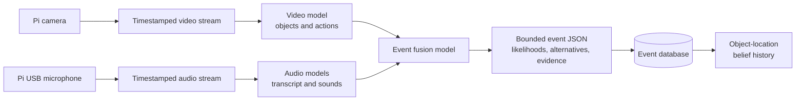

# Apartment object-permanence research prototype

**Status:** In progress
**Goal:** Evaluate whether a local home system can help find selected household objects after people move them out of camera view.

## Scope and assumptions

- A fixed camera observes one high-value area first, such as an entry table, desk, or living-room surface.
- A Raspberry Pi is a sensing node only: it captures timestamped audio/video and streams both to the existing computer. The computer performs inference and stores only the event data needed for the experiment.
- The first version tracks a small, chosen set of objects (for example keys, wallet, remote, and glasses) and reports their last confirmed location.
- The system must say when it is uncertain. It does not claim to know an object's location after an unobserved move.
- Anyone who can enter the recorded area must know the camera and microphone are active and consent to the experiment. Audio is processed locally, has a defined short retention period, and has a physical/software disable control.

## Minimum hardware

| Item | Purpose | Notes |
| --- | --- | --- |
| Existing computer | Local processing, event database, and dashboard | Keep all processing and storage local initially. |
| Raspberry Pi 2 or Pi Zero W | Camera/audio sensing node | The Pi 2 is suitable for a low-resolution stream; neither board should run the main vision model. Use whichever is most reliable on Wi-Fi. |
| Compatible Raspberry Pi camera and CSI ribbon cable | Video capture | A Pi Camera Module v2 or compatible CSI camera is a simple starting point. Confirm the connector/ribbon orientation for the selected Pi. |
| USB microphone compatible with the Pi | Audio capture | Use a basic UAC/USB Audio Class microphone. Record mono, speech-quality audio; the computer performs speech and sound inference. |
| Stable 5 V power supply for the Pi | Continuous operation | Use a supply rated for the board; avoid an unreliable phone charger. |
| microSD card (16 GB or larger) | Raspberry Pi OS and stream software | Use a quality card; write-heavy video archival is deliberately out of scope. |
| Mount or small tripod | Repeatable camera position | Place it to see the selected object surface and approach paths without covering more of the home than necessary. |
| Wi-Fi or Ethernet connection | Pi-to-computer stream | Ethernet is preferable for a Pi 2 when practical; Pi Zero W is Wi-Fi only without an adapter. |

### Optional hardware for later experiments

- Physical camera/microphone power switch or shutter, plus a visible recording indicator.
- A USB Ethernet adapter for the Pi Zero W if Wi-Fi proves unreliable.
- A second camera only after the single-camera baseline is measured.

## Research questions

1. Is an event history more useful than a simple last-seen location for finding objects moved by people?
2. Does timestamp-aligned audio improve event detection or object-location estimates over video alone?
3. Can the system maintain calibrated confidence through occlusion and unobserved movement?
4. How often does it reduce the time needed to find a tracked object?

## Phased plan

1. **Define the pilot** — choose one room/area, 5–10 tracked objects, and 20–30 realistic search episodes.
   **Verify:** write down the ground-truth location and outcome for every episode.
2. **Set up the sensing node** — mount the Pi camera and microphone, stream low-resolution video and mono audio to the computer, and timestamp both from the same Pi clock.
   **Verify:** view/hear both local streams for at least one hour with no dropped connection; a known clap or spoken phrase aligns with the corresponding video moment within one second.
3. **Build the video baseline** — detect selected objects where visible and save object, time, camera, and last confirmed location.
   **Verify:** test known placements and confirm that each saved event matches the footage.
4. **Extract modality evidence** — use separate local models to turn short video and audio windows into structured evidence: visible objects/actions, transcript, and sounds such as a drawer closing or object placement.
   **Verify:** manually review a labeled sample of model outputs and record modality-specific precision and recall.
5. **Fuse event candidates** — combine evidence from a shared time window into canonical events; produce structured JSON with confidence, supporting evidence, and alternatives. Mark an object as uncertain when it leaves view with a person.
   **Verify:** review a small labeled set and calculate pickup/place event precision and recall.
6. **Compare approaches** — compare (A) last-seen location, (B) video-aware event history, and (C) audio-video event history.
   **Verify:** measure correct answers, search time, and confidence calibration across the planned episodes.
7. **Decide whether to expand** — document findings, failure cases, privacy impact, and the next experiment (second camera or active search).
   **Verify:** produce a short results summary and keep only the data allowed by the retention policy.

## Event-processing design



1. The Pi gives every audio and video chunk a capture timestamp from its clock. The computer stores the streams and uses a small time window around a possible event (for example, five seconds before and after it).
2. A video model generates evidence such as `remote visible on coffee_table` or `person carrying remote toward doorway`. An audio pipeline generates a speech transcript and sound evidence such as `drawer_close` or `object_placed`.
3. A fusion/classification step evaluates the aligned evidence and proposes one or more canonical events. It should output a bounded JSON schema, not free-form prose treated as fact.
4. The database saves the event, probability, alternatives, and provenance. A later state-estimation step updates each object's likely location from the event history.

Example event candidate:

```json
{
  "event_name": "object_lost_from_view",
  "object_id": "remote",
  "event_start": "2026-08-16T15:30:12.420-05:00",
  "event_end": "2026-08-16T15:30:15.100-05:00",
  "area": "living_room",
  "likely_location": "unknown_after_bedroom_doorway",
  "likelihood": 0.72,
  "alternatives": [
    {"event_name": "object_placed_on_side_table", "likelihood": 0.19}
  ],
  "evidence": [
    {"modality": "video", "summary": "person carried remote toward doorway", "likelihood": 0.84},
    {"modality": "audio", "summary": "speech mentions bedroom", "likelihood": 0.63}
  ],
  "model_version": "...",
  "review_status": "unreviewed"
}
```

The text summaries are evidence, not truth. Keep the numeric likelihoods, model versions, timestamps, and source references so results can be audited and model performance can be measured.

## Initial data model

For every observation or event, retain: object label, timestamp range, camera/area, event type (`seen`, `picked_up`, `placed`, `lost_from_view`, `rediscovered`), estimated location, likelihood, alternatives, modality-specific evidence, model version, review status, and an optional short-lived audio/video source reference. Do not retain continuous audio/video by default beyond the defined review window.

## Success criteria for the first milestone

- A local dashboard or command can answer: “Where was the remote last confirmed?”
- The answer includes time, area, and confidence rather than asserting an unknown location.
- The Pi reliably provides time-aligned local video and audio streams to the computer.
- The pilot has a written privacy notice, explicit retention period, and a way to disable sensing.

## Immediate next actions

1. Inventory the available Pi model, camera, USB microphone, power supply, microSD card, and available network connection.
2. Choose the first camera view and the five initial tracked objects.
3. Bring up timestamped local-only video and audio streams before adding models or object-location logic.
